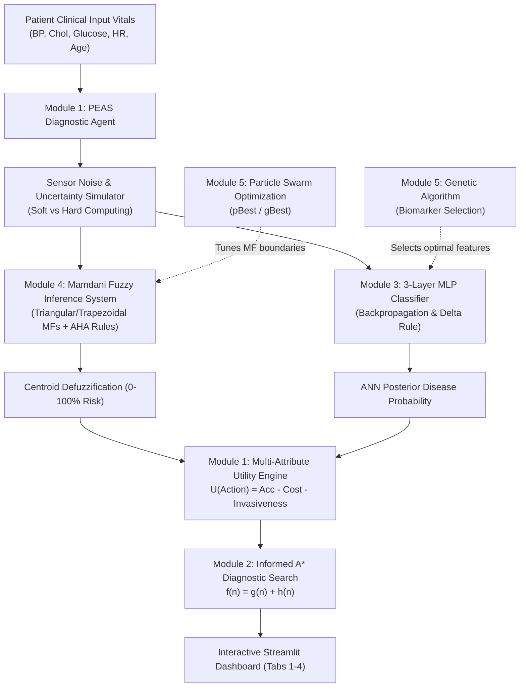

# CardioVision CDSS: Intelligent Clinical Decision Support System

An academic-grade, modular Clinical Decision Support System (CDSS) for cardiovascular and metabolic risk stratification, integrating Intelligent Agent Architectures, Heuristic State-Space Search, Multi-Layer Perceptrons trained via Backpropagation, Mamdani/Sugeno Fuzzy Inference Systems, and Evolutionary/Swarm Metaheuristic Optimization.

Developed for **CSE315: Artificial Intelligence and Soft Computing (AISC)**.

---

## 🌟 Key Architecture & Capabilities



### Module 1: AI & Soft Computing Foundations (`src/agents/`)
- **PEAS Formalization:** Performance measure ($P$), Environment ($E$), Actuators ($A$), and Sensors ($S$).
- **Goal-Based & Utility-Based Diagnostic Agents:** Synthesizes multi-attribute utility:
  $$U(a) = w_1 \cdot \text{Certainty}(a) - w_2 \cdot \frac{\text{Cost}(a)}{\text{MaxCost}} - w_3 \cdot \frac{\text{Invasiveness}(a)}{\text{MaxInv}} - w_4 \cdot \text{ResidualRisk}(a)$$
- **Soft vs. Hard Computing Benchmark:** Demonstrates catastrophic category flipping of Boolean thresholding under simulated Gaussian sensor noise versus the continuous, graceful degradation of fuzzy reasoning.

### Module 2: Problem Solving by Intelligent Search (`src/search/`)
- **State-Space Formulation:** Diagnostic pathway sequencing where nodes represent sets of performed tests.
- **Informed A\* Search:** Evaluates states via $f(n) = g(n) + h(n)$, combining monetary cost (\$) and patient discomfort into $g(n)$, with an **admissible and consistent Shannon entropy heuristic** $h(n) \le h^*(n)$.
- **Multi-Algorithm Comparison:** Side-by-side benchmarking of A\* Search, Greedy Best-First Search, and Steepest-Ascent Hill Climbing.

### Module 3: Artificial Neural Networks (`src/models/`)
- **3-Layer MLP Classifier from Scratch:** Implemented in pure NumPy without deep learning frameworks ($D \to 16 \to 8 \to 1$).
- **Supervised Backpropagation & Generalized Delta Rule:** Uses Binary Cross-Entropy loss, ReLU activations, Sigmoid output, Momentum SGD ($\beta = 0.9$), and L2 weight regularization.
- **Clinical Evaluation:** Generates confusion matrices, Precision, Recall (Sensitivity), Specificity, F1-Score, and ROC-AUC metrics.

### Module 4: Fuzzy Logic Inference Systems (`src/fuzzy/`)
- **Fuzzy Membership Functions:** Clean NumPy implementations of Triangular ($\text{trimf}$), Trapezoidal ($\text{trapmf}$), and Gaussian ($\text{gaussmf}$) curves.
- **Mamdani Min-Max FIS:** 16 American Heart Association (AHA) guided linguistic clinical rules with Minimum T-norm for AND, Maximum S-norm for OR, Mamdani implication clipping, and Maximum aggregation.
- **Defuzzification Engine:** Centroid (Center of Gravity), Mean of Maxima (MOM), and Bisector methods.
- **Sugeno (TSK) FIS & ANFIS Comparison:** Zero-order and first-order linear polynomial consequents with weighted average defuzzification and 5-layer ANFIS structural mapping.

### Module 5: Evolutionary Algorithms & Swarm Intelligence (`src/optimization/`)
- **Binary Genetic Algorithm (`genetic_selector.py`):** Chromosome-encoded biomarker feature selection with Roulette-Wheel / Tournament selection, Single-point crossover, bit-flip mutation, and Elitism.
- **Particle Swarm Optimization (`pso_tuner.py`):** Multi-dimensional continuous swarm adjusting Mamdani membership inflection parameters via cognitive ($p\text{Best}$) and social ($g\text{Best}$) updates with time-varying inertia weight ($w$) decay.

---

## 💻 Tech Stack
- **Language:** Python 3.10+
- **Numerical Computing & Scientific Libraries:** NumPy, SciPy, Pandas, Scikit-learn
- **Data Visualization:** Matplotlib (Agg backend)
- **Interactive Web Interface:** Streamlit (v1.30+)
- **Testing Framework:** Python standard library `unittest`

---

## 📁 Repository Structure

```text
fuzzy-medical-diagnostic/
├── .gitignore                          # Excludes bytecode, envs, and docs/ viva notes
├── README.md                           # Professional project documentation
├── requirements.txt                    # Pinned lightweight dependencies
├── features.md                         # Detailed Syllabus-to-Code mapping matrix
├── data/
│   └── heart.csv                       # Standalone UCI Heart Disease dataset (303 records)
├── docs/
│   ├── AI & Computing Course Structure.pdf # Syllabus reference document
│   └── viva_notes.md                   # Complete viva preparation and mathematical derivations
├── src/
│   ├── __init__.py
│   ├── agents/
│   │   ├── __init__.py
│   │   └── diagnostic_agent.py         # Module 1: PEAS, Goal & Utility Agents, Soft vs Hard
│   ├── search/
│   │   ├── __init__.py
│   │   └── astar_pathway.py            # Module 2: A* Search, Admissible Heuristic, Pathway Optimizer
│   ├── models/
│   │   ├── __init__.py
│   │   └── mlp_classifier.py           # Module 3: 3-Layer MLP, Backpropagation & Delta Rule
│   ├── fuzzy/
│   │   ├── __init__.py
│   │   ├── membership.py               # Module 4: Triangular & Trapezoidal Membership Functions
│   │   ├── mamdani_fis.py              # Module 4: Mamdani FIS Engine & Centroid Defuzzification
│   │   └── sugeno_fis.py               # Module 4: Sugeno TSK FIS & ANFIS Architecture
│   └── optimization/
│       ├── __init__.py
│       ├── genetic_selector.py         # Module 5: Binary GA for Biomarker Feature Selection
│       └── pso_tuner.py                # Module 5: PSO Swarm for Fuzzy Membership Tuning
├── tests/
│   ├── __init__.py
│   └── test_cdss.py                    # Automated test suite covering Modules 1-5
└── app/
    ├── __init__.py
    └── app.py                          # 4-Tab Interactive Streamlit Dashboard
```

---

## 🚀 Installation & Setup

### 1. Clone or Open Project
Navigate to the project root directory:
```bash
cd D:\Zenith\Projects\fuzzy-medical-diagnostic
```

### 2. Set Up Virtual Environment (Recommended)
```bash
python -m venv .venv
# On Windows PowerShell:
.venv\Scripts\Activate.ps1
# On Linux/macOS:
source .venv/bin/activate
```

### 3. Install Dependencies
```bash
pip install -r requirements.txt
```

---

## 🧪 Running Automated Unit Tests
To execute the comprehensive test suite across all 5 modules:
```bash
python -m unittest discover -s tests -v
```
All 14 tests run deterministically in under 1 second without network access.

---

## 🖥️ Launching the Interactive Streamlit Web UI
To start the multi-tab interactive clinical dashboard:
```bash
streamlit run app/app.py
```
Open your browser at `http://localhost:8501`.

### Dashboard Tabs Overview
1. **Tab 1: Patient Triage & PEAS Agent**
   - Interactive sliders for patient hemodynamics (Blood Pressure, Cholesterol, Fasting Glucose, Max HR, Age).
   - Side-by-side comparison of Mamdani Fuzzy Risk (0-100%) vs. MLP Probability (0-1).
   - Multi-attribute utility triage tier with clinical pharmacotherapy guidance.
   - Sensor noise robustness experiment demonstrating soft vs. hard computing.
2. **Tab 2: Fuzzy Membership & Inference Visualizer**
   - Dynamic Matplotlib plots for input membership functions with patient input markers.
   - Mamdani implication clipping and Centroid Defuzzification visualization.
   - Sugeno FIS vs. Mamdani comparison and 5-layer ANFIS matrix.
3. **Tab 3: A\* Diagnostic Pathway Search**
   - Interactive search configuration (target diagnostic certainty, budget, discomfort penalty).
   - Multi-algorithm benchmark comparing A\*, Greedy Best-First, and Steepest-Ascent Hill Climbing.
   - Step-by-step trace of search tree nodes ($f(n) = g(n) + h(n)$).
4. **Tab 4: Evolutionary & Swarm Convergence**
   - Genetic Algorithm execution for biomarker panel selection with generational fitness curves.
   - Particle Swarm Optimization execution for tuning membership inflection points with RMSE loss curves.

---

## 📖 Syllabus Mapping & Viva Reference
For university evaluation:
- See `features.md` for a 1-to-1 matrix mapping every syllabus topic to its code implementation.
- Detailed theoretical derivations (Backpropagation, Centroid integration, A\* admissibility proofs, and 35 viva Q&As) are organized in `docs/viva_notes.md`.
