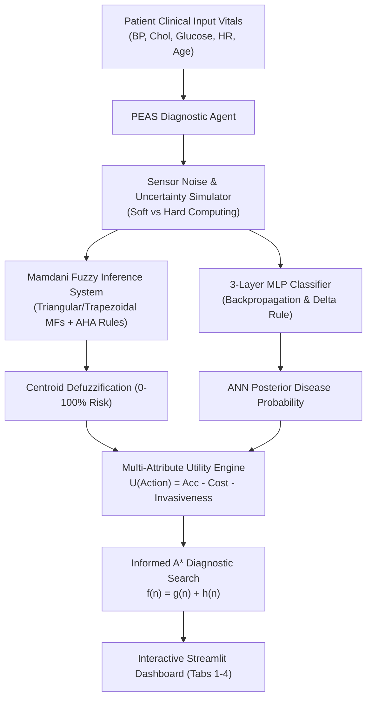

# CardioVision CDSS: Intelligent Clinical Decision Support System

An academic-grade, modular Clinical Decision Support System (CDSS) for cardiovascular and metabolic risk stratification, integrating Intelligent Agent Architectures, Heuristic State-Space Search, Multi-Layer Perceptrons trained via Backpropagation, Mamdani/Sugeno Fuzzy Inference Systems, and Interactive Clinical Database Analytics.

Engineered for automated clinical risk stratification and diagnostic test sequencing under physiological uncertainty and sensor noise.

---

## Key Architecture & Capabilities



### Intelligent Agents & Soft Computing Foundations (`src/agents/`)
- **PEAS Formalization:** Performance measure ($P$), Environment ($E$), Actuators ($A$), and Sensors ($S$).
- **Goal-Based & Utility-Based Diagnostic Agents:** Synthesizes multi-attribute utility:
  $$U(a) = w_1 \cdot \text{Certainty}(a) - w_2 \cdot \frac{\text{Cost}(a)}{\text{MaxCost}} - w_3 \cdot \frac{\text{Invasiveness}(a)}{\text{MaxInv}} - w_4 \cdot \text{ResidualRisk}(a)$$
- **Soft vs. Hard Computing Benchmark:** Demonstrates catastrophic category flipping of Boolean thresholding under simulated Gaussian sensor noise versus the continuous, graceful degradation of fuzzy reasoning.

### Intelligent Pathway Search (`src/search/`)
- **State-Space Formulation:** Diagnostic pathway sequencing where nodes represent sets of performed tests.
- **Informed A\* Search:** Evaluates states via $f(n) = g(n) + h(n)$, combining monetary cost (\$) and patient discomfort into $g(n)$, with an **admissible and consistent Shannon entropy heuristic** $h(n) \le h^*(n)$.
- **Multi-Algorithm Comparison:** Side-by-side benchmarking of A\* Search, Greedy Best-First Search, and Steepest-Ascent Hill Climbing.

### Feedforward Neural Network (`src/models/`)
- **3-Layer MLP Classifier from Scratch:** Implemented in pure NumPy without deep learning frameworks ($D \to 16 \to 8 \to 1$).
- **Supervised Backpropagation & Generalized Delta Rule:** Uses Binary Cross-Entropy loss, ReLU activations, Sigmoid output, Momentum SGD ($\beta = 0.9$), and L2 weight regularization.
- **Clinical Evaluation:** Generates confusion matrices, Precision, Recall (Sensitivity), Specificity, F1-Score, and ROC-AUC metrics.

### Fuzzy Logic Inference Systems (`src/fuzzy/`)
- **Fuzzy Membership Functions:** Clean NumPy implementations of Triangular ($\text{trimf}$), Trapezoidal ($\text{trapmf}$), and Gaussian ($\text{gaussmf}$) curves.
- **Mamdani Min-Max FIS:** 16 American Heart Association (AHA) guided linguistic clinical rules with Minimum T-norm for AND, Maximum S-norm for OR, Mamdani implication clipping, and Maximum aggregation.
- **Defuzzification Engine:** Centroid (Center of Gravity), Mean of Maxima (MOM), and Bisector methods.
- **Sugeno (TSK) FIS & ANFIS Comparison:** Zero-order and first-order linear polynomial consequents with weighted average defuzzification and 5-layer ANFIS structural mapping.

### Clinical Database & System Documentation (`data/` & `app/`)
- **UCI Cleveland Heart Disease Cohort Analytics:** Interactive demographic exploration, resting hemodynamics clustering, and descriptive biomarker statistics.
- **Clinical Decision Architecture & Knowledge Base:** Comprehensive mapping of AHA/ACC 2017 blood pressure guidelines, NCEP ATP III cholesterol guidelines, and ADA diabetes criteria alongside mathematical formulations and diagnostic test catalog pricing.

---

## Tech Stack
- **Language:** Python 3.10+
- **Numerical Computing & Scientific Libraries:** NumPy, SciPy, Pandas, Scikit-learn
- **Data Visualization:** Matplotlib (Agg backend)
- **Interactive Web Interface:** Streamlit (v1.30+)
- **Testing Framework:** Python standard library `unittest`

---

## Repository Structure

```text
fuzzy-medical-diagnostic/
├── .gitignore                          # Excludes bytecode, local environments, and local notes
├── README.md                           # Professional project documentation
├── requirements.txt                    # Pinned lightweight dependencies
├── data/
│   └── heart.csv                       # Standalone UCI Heart Disease dataset (303 records)
├── src/
│   ├── __init__.py
│   ├── agents/
│   │   ├── __init__.py
│   │   └── diagnostic_agent.py         # PEAS, Goal & Utility Agents, Soft vs Hard
│   ├── search/
│   │   ├── __init__.py
│   │   └── astar_pathway.py            # A* Search, Admissible Heuristic, Pathway Optimizer
│   ├── models/
│   │   ├── __init__.py
│   │   └── mlp_classifier.py           # 3-Layer MLP, Backpropagation & Delta Rule
│   └── fuzzy/
│       ├── __init__.py
│       ├── membership.py               # Triangular & Trapezoidal Membership Functions
│       ├── mamdani_fis.py              # Mamdani FIS Engine & Centroid Defuzzification
│       └── sugeno_fis.py               # Sugeno TSK FIS & ANFIS Architecture
├── extra/                              # Saved optimization modules (GA & PSO) for future extension
│   ├── optimization/
│   ├── tab4_optimization_code.py
│   └── test_optimization.py
├── tests/
│   ├── __init__.py
│   └── test_cdss.py                    # Automated test suite covering all active components
└── app/
    ├── __init__.py
    └── app.py                          # 4-Tab Interactive Streamlit Dashboard
```

---

## Installation & Setup

### 1. Clone or Open Project
Navigate to the project root directory:
```bash
cd D:\Zenith\Projects\fuzzy-medical-diagnostic
```

### 2. Set Up Virtual Environment (Recommended)
```bash
python -m venv .venv
# On Windows PowerShell:
.venv\Scripts\Activate.ps1
# On Linux/macOS:
source .venv/bin/activate
```

### 3. Install Dependencies
```bash
pip install -r requirements.txt
```

---

## Running Automated Unit Tests
To execute the comprehensive test suite:
```bash
python -m unittest discover -s tests -v
```
All 12 tests run deterministically in under 0.1 seconds without network access.

---

## Launching the Interactive Streamlit Web UI
To start the multi-tab interactive clinical dashboard:
```bash
streamlit run app/app.py
```
Open your browser at `http://localhost:8501`.

### Dashboard Tabs Overview
1. **Tab 1: Patient Triage & PEAS Agent**
   - Interactive sliders for patient hemodynamics (Blood Pressure, Cholesterol, Fasting Glucose, Max HR, Age).
   - Side-by-side comparison of Mamdani Fuzzy Risk (0-100%) vs. MLP Probability (0-1).
   - Multi-attribute utility triage tier with clinical pharmacotherapy guidance.
   - Sensor noise robustness experiment demonstrating soft vs. hard computing.
2. **Tab 2: Fuzzy Membership & Inference Visualizer**
   - Dynamic Matplotlib plots for input membership functions with patient input markers.
   - Mamdani implication clipping and Centroid Defuzzification visualization.
   - Sugeno FIS vs. Mamdani comparison and 5-layer ANFIS matrix.
3. **Tab 3: A\* Diagnostic Pathway Search**
   - Interactive search configuration (target diagnostic certainty, budget, discomfort penalty).
   - Multi-algorithm benchmark comparing A\*, Greedy Best-First, and Steepest-Ascent Hill Climbing.
   - Step-by-step trace of search tree nodes ($f(n) = g(n) + h(n)$).
4. **Tab 4: Clinical Database & System Documentation**
   - Interactive exploration of the UCI Cleveland cohort with biomarker scatter clustering and age density histograms.
   - Comprehensive clinical practice guidelines (AHA/ACC, NCEP ATP-III, ADA) and mathematical formulation references.
